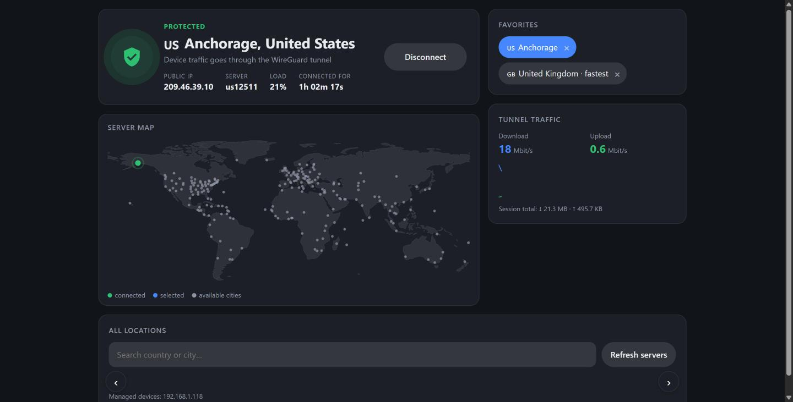
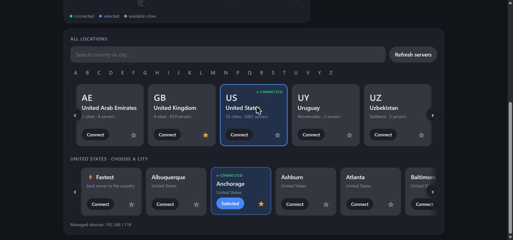

<p align="center"></p>

<p align="center">
  <b>Route only selected devices of your home network through a WireGuard VPN — managed from Home Assistant.</b><br>
  <a href="#italiano">🇮🇹 Italiano più sotto</a>
</p>

---

> **Unofficial project.** TunnelGate is not affiliated with, endorsed by or connected to Nord Security / NordVPN.
> It uses your own NordVPN subscription through the same public API used by the official apps, which may change without notice.

## What it does

TunnelGate turns the machine running Home Assistant OS (e.g. a Raspberry Pi) into a **VPN gateway for a few chosen devices** — a smart TV, a streaming stick, a console — while everything else in your home keeps using the normal connection.

```
TV / streaming stick ──(gateway = Home Assistant)──> TunnelGate ──WireGuard──> VPN server
everything else ───────────────────────────────────> your router, as usual
```

Why a gateway instead of a VPN app on the device?

- Many TV apps refuse to play when a VPN is running **on the device itself**. Behind TunnelGate the device just sees a normal wired/Wi-Fi network.
- Devices that have no VPN app at all can still use the VPN.
- You switch the VPN on/off and change country from **Home Assistant**: dashboard, automations, voice assistants.

<p align="center">
  
  
</p>

## Features

- 🛡️ **WireGuard (NordLynx) tunnel** with automatic server choice (provider recommendations) and automatic reconnection.
- 🎯 **Per-device**: only the IP addresses you list go through the tunnel. Home Assistant and the rest of the LAN are untouched.
- 🔒 **Kill switch**: if the tunnel drops, the selected devices are blocked instead of leaking your real IP.
- 🧭 **DNS leak protection**: device DNS is answered through the tunnel and IPv6 (AAAA) answers are hidden, so devices stay on IPv4 → tunnel.
- 📏 **MSS clamping** for the smaller tunnel MTU (fixes streaming apps that hang with timeouts).
- 🖥️ **Sidebar panel** (Ingress): status, public IP, live traffic, world map, favourites, every country and city.
- 🏠 **MQTT entities** created automatically: VPN switch, country and city selects, status / server / public IP / location sensors.
- 🌍 English and Italian.

## Requirements

- Home Assistant **OS** (or Supervised) on `aarch64` (Raspberry Pi 4/5) or `amd64`.
- An active **NordVPN subscription** and an **access token** (see below).
- The **Mosquitto broker** add-on (optional, only for the MQTT entities).
- Devices you want to route must accept a **manual network configuration** (static IP + gateway). Most TVs and streaming sticks do.

## Installation

1. In Home Assistant open **Settings → Add-ons → Add-on Store → ⋮ → Repositories** and add:
   ```
   https://github.com/marco2181/ha-tunnelgate
   ```
   [](https://my.home-assistant.io/redirect/supervisor_add_addon_repository/?repository_url=https%3A%2F%2Fgithub.com%2Fmarco2181%2Fha-tunnelgate)
2. Install **TunnelGate**.
3. On the add-on **Info** tab turn **Protection mode off** (the add-on manages routing and firewall rules on the host) and enable **Show in sidebar**.
4. Configure it (next section) and press **Start**.

Updates are published to the same repository: Home Assistant shows *Update available*, or updates by itself if you enable **Auto update**.

## Configuration

| Option | Description |
|---|---|
| `token` | NordVPN access token. Nord Account → NordVPN → *Manual setup* → *Generate new token* (choose "doesn't expire"). |
| `clients` | IPv4 addresses of the devices to route through the VPN, e.g. `192.168.1.118`. |
| `lan_interface` | LAN interface. Auto-detected if it doesn't exist (`end0` on a Raspberry Pi). |
| `default_country` / `default_city` | Used on the very first start, e.g. `US` / `Chicago`. Empty city = fastest server. |
| `kill_switch_on_stop` | If on (and the VPN was on), devices stay offline while the add-on is stopped. Default off: they go out without VPN. |
| `language` | `en` or `it` for entity names. The panel follows your browser language. |

### Configure the device

On each device listed in `clients` set a **manual/static** network configuration:

| Field | Value (example) |
|---|---|
| IP address | `192.168.1.118` (same as in `clients`) |
| Prefix / netmask | `24` / `255.255.255.0` |
| Gateway | **IP of your Home Assistant**, e.g. `192.168.1.2` |
| DNS | `8.8.8.8` and `8.8.4.4` (any public IPv4 DNS) |

Then reserve that IP for the device in your router's DHCP settings, so nothing else gets it.

> ⚠️ **Use IPv4 DNS servers only on the device.** If the device also receives an IPv6 DNS server from your router it can reach services over IPv6 directly, bypassing the gateway. A static IPv4 configuration normally removes it. To be 100% sure, disable IPv6 on your LAN.

## Using it

- **Panel** (sidebar → *TunnelGate*): connect / disconnect, pick a country (horizontal cards, A–Z jump) and a city, ★ favourites, live traffic and map.
- **Entities** (with MQTT): `switch.tunnelgate_vpn`, `select.tunnelgate_country`, `select.tunnelgate_city`, `sensor.tunnelgate_public_ip`, … (Italian names if `language: it`).

Example automation — VPN on when the TV turns on:

```yaml
automation:
  - alias: VPN on with the TV
    triggers:
      - trigger: state
        entity_id: media_player.living_room_tv
        to: "on"
    actions:
      - action: switch.turn_on
        target:
          entity_id: switch.tunnelgate_vpn
```

## How it works

- A kernel WireGuard interface (`tgate0`) connects to a server picked from the provider's recommendations.
- Policy routing (`ip rule from <client> lookup 51820`) sends **only** client traffic into the tunnel, with a blackhole fallback route (kill switch).
- iptables: forwarding + MASQUERADE, DNS (port 53) redirected to a small built-in resolver, DoT (853) rejected, ICMP redirects suppressed, TCP MSS clamped.
- With the VPN **off**, clients are still forwarded to your router, so the device keeps working with its static configuration.

## Troubleshooting

| Symptom | Fix |
|---|---|
| `ip_forward is 0` in the log | Turn **Protection mode** off and restart the add-on. |
| "No server answered" | Try another city, or press *Refresh servers* in the panel. |
| Token error (401/403) | Generate a new token in Nord Account and paste it in the configuration. |
| Device has no internet | The add-on must be running; if Home Assistant is off, set the device back to automatic (DHCP). |
| App still sees your real location | Check the device has no IPv6 DNS (see warning above). |

## Limitations

- Only devices that use the Home Assistant host as gateway are routed.
- IPv6 traffic from the devices cannot be routed by the gateway: it is neutralised through DNS (see above).
- The VPN provider's API is not officially documented and may change.
- Streaming services' terms may restrict VPN use; you are responsible for how you use it.

## License

[MIT](LICENSE)

---

<a id="italiano"></a>

## 🇮🇹 Italiano

**TunnelGate** trasforma il computer con Home Assistant OS (es. un Raspberry Pi) in un **gateway VPN solo per alcuni dispositivi** — TV, chiavetta streaming, console — mentre il resto della casa continua a usare la connessione normale.

> **Progetto non ufficiale**, non affiliato a Nord Security / NordVPN. Usa il tuo abbonamento NordVPN tramite le stesse API pubbliche delle app ufficiali, che possono cambiare.

### Perché un gateway e non l'app VPN sul dispositivo?
- Molte app per TV non riproducono se la VPN è attiva **sul dispositivo stesso**. Con TunnelGate il dispositivo vede una rete normale.
- Funziona anche con dispositivi che non hanno un'app VPN.
- Accendi/spegni la VPN e cambi paese da **Home Assistant**: dashboard, automazioni, assistente vocale.

### Funzioni
Tunnel WireGuard (NordLynx) con scelta automatica del server e riconnessione · solo gli IP indicati passano dalla VPN · **kill switch** · protezione dalle fughe DNS/IPv6 · correzione MTU/MSS per lo streaming · **pannello nella barra laterale** con stato, IP, traffico, mappa, preferiti, paesi e città · **entità MQTT** automatiche.

### Installazione
1. *Impostazioni → Componenti aggiuntivi → Store → ⋮ → Repository* e aggiungi `https://github.com/marco2181/ha-tunnelgate`.
2. Installa **TunnelGate**.
3. Nella scheda **Info** disattiva **Modalità protezione** e attiva **Mostra nella barra laterale**.
4. Nella scheda **Configurazione** inserisci:
   - `token`: Nord Account → NordVPN → *Configurazione manuale* → *Genera nuovo token* (scegli "non scade");
   - `clients`: IP dei dispositivi da far passare in VPN (es. `192.168.1.118`);
   - `language: it` per avere le entità in italiano.
5. **Avvia**.

Gli aggiornamenti arrivano dalla repo: Home Assistant mostra *Aggiornamento disponibile*, oppure si aggiorna da solo se attivi **Aggiornamento automatico**.

### Configurare il dispositivo (es. Fire TV)
Imposta la rete **manualmente**: IP `192.168.1.118` (come in `clients`), prefisso `24`, **gateway = IP di Home Assistant** (es. `192.168.1.2`), DNS `8.8.8.8` e `8.8.4.4`. Poi nel router riserva quell'IP al dispositivo.

> ⚠️ Usa solo DNS IPv4 sul dispositivo: se riceve anche un DNS IPv6 dal router può uscire in IPv6 senza passare dal gateway. Per sicurezza totale disattiva l'IPv6 nella rete di casa.

### Problemi comuni
- `ip_forward is 0` nel log → disattiva la *Modalità protezione* e riavvia.
- "No server answered" → prova un'altra città o *Aggiorna server* nel pannello.
- Errore token (401/403) → genera un nuovo token.
- Dispositivo senza internet → l'add-on deve essere avviato; se Home Assistant è spento rimetti la rete del dispositivo in automatico (DHCP).

Licenza [MIT](LICENSE).
